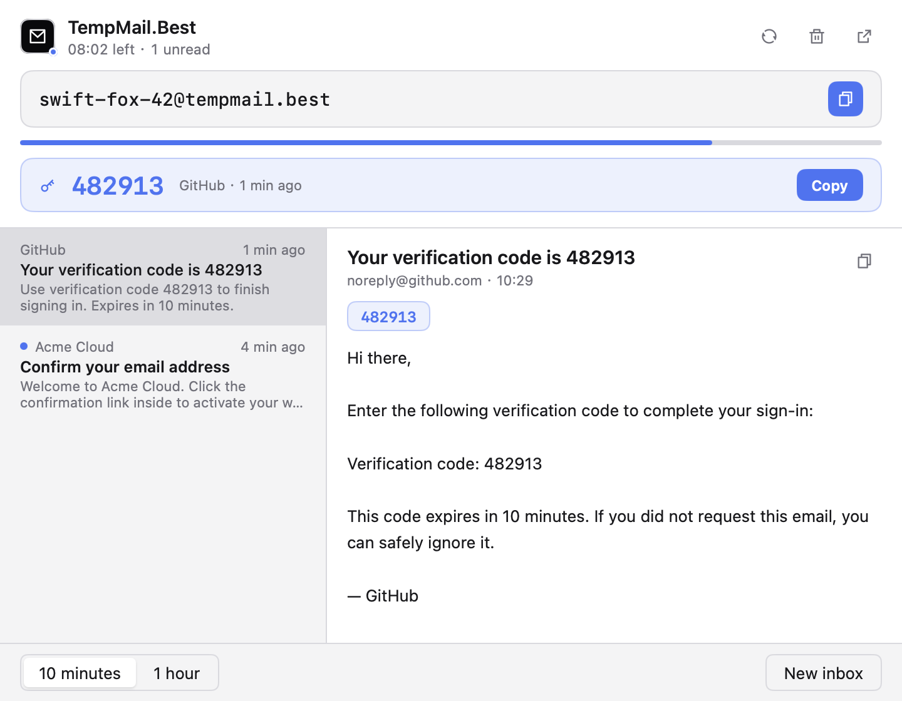
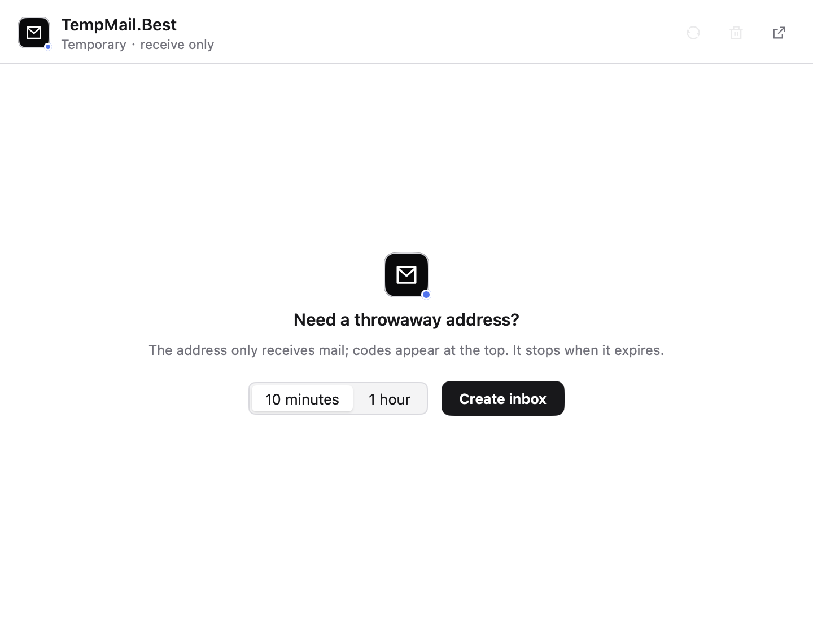

English | [简体中文](README.zh-CN.md)

# TempMail.Best for Metrix.Bar

Create a 10-minute or 1-hour disposable [TempMail.Best](https://tempmail.best) inbox right from your menu bar in [Metrix.Bar](https://metrix.bar/) — read messages in a native split window and copy verification codes in one click, with no API key required.

|                                                                                                                   Inbox & Code Copy                                                                                                                   |                                                                                                                  Create Inbox                                                                                                                   |
| :---------------------------------------------------------------------------------------------------------------------------------------------------------------------------------------------------------------------------------------------------: | :---------------------------------------------------------------------------------------------------------------------------------------------------------------------------------------------------------------------------------------------: |
| <picture><source media="(prefers-color-scheme: dark)" srcset="docs/inbox-dark.webp" /><source media="(prefers-color-scheme: light)" srcset="docs/inbox-light.webp" /></picture> | <picture><source media="(prefers-color-scheme: dark)" srcset="docs/empty-dark.webp" /><source media="(prefers-color-scheme: light)" srcset="docs/empty-light.webp" /></picture> |

## What You Can Do

- **Create a throwaway address in one click**: Choose a 10-minute or 1-hour lifetime without configuring any API key. The official TempMail.Best challenge runs locally inside Metrix.Bar and can be canceled at any time.
- **Copy verification codes instantly**: Incoming verification codes are detected automatically from the latest message, pinned at the top of the window for one-click copy, and shown right in new-mail desktop notifications.
- **Read messages safely**: Browse the latest 20 messages in a native two-column window. Mail is rendered as plain text (no scripts or remote tracking images), preserves verification links, and pages long messages with full-text copy.
- **Stay in control**: Refreshes every 15s while open and 60s when closed, and stops automatically on expiry without creating unsolicited addresses. Replacing or deleting an inbox requires confirmation, and failed replacements keep your current address.

## Install

1. Requires **Metrix.Bar 0.3.0+**. Download [tempmail.bar](dist/tempmail.bar?raw=1) and import it into [Metrix.Bar](https://metrix.bar/).
2. Open the TempMail.Best window, pick **10 minutes** or **1 hour**, and click **Create inbox**.

## Settings

| Setting             | Default | What it controls                                               |
| ------------------- | ------- | -------------------------------------------------------------- |
| **Language**        | English | Display language (`English`, `简体中文`)                       |
| **Mailbox session** | _Auto_  | Managed automatically in your OS Keychain (no manual input)    |
| **New mail alerts** | On      | Desktop notifications on new mail with detected codes in title |

## Permissions & Limits

- **Network**: Only connects to `https://tempmail.best` ([Official Agent Skill](https://tempmail.best/skills/tempmail-best/SKILL.md) · [OpenAPI](https://tempmail.best/api/agent/v1/openapi)).
- **Receive-only**: No sending, replies, forwarding, attachments, single-message deletion, or cross-device sync.
- **Local storage**: Active mailbox credentials stay in your OS Keychain; message bodies remain in memory only.

## Development

```sh
pnpm install
pnpm check
pnpm test
pnpm build
```

The build writes the importable bundle to `dist/tempmail.bar`.

## License

[Apache-2.0](LICENSE).
