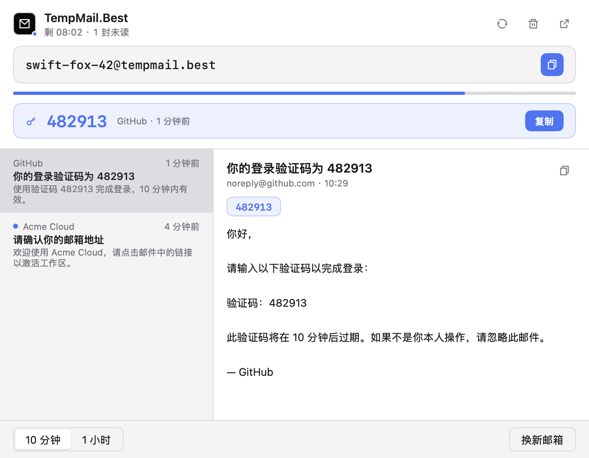
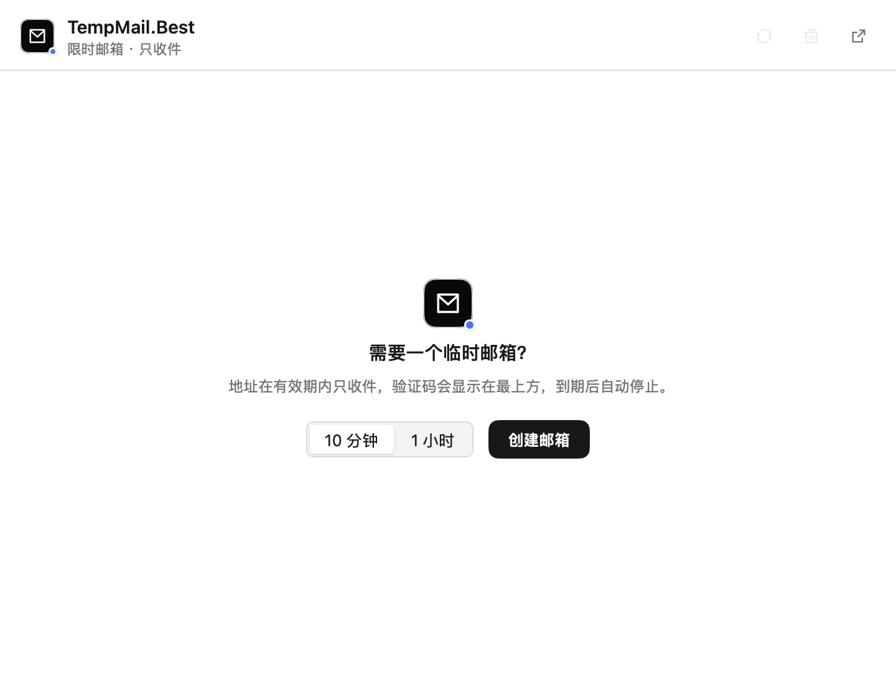

[English](README.md) | 简体中文

# TempMail.Best 临时邮箱看板

在 [Metrix.Bar](https://metrix.bar/) 中一键创建 10 分钟或 1 小时的 [TempMail.Best](https://tempmail.best) 临时邮箱，在原生分栏窗口阅读来信并一键复制验证码，无需任何 API Key。

|                                                                                                                    收件箱与验证码置顶                                                                                                                    |                                                                                                                   创建临时邮箱                                                                                                                   |
| :------------------------------------------------------------------------------------------------------------------------------------------------------------------------------------------------------------------------------------------------------: | :----------------------------------------------------------------------------------------------------------------------------------------------------------------------------------------------------------------------------------------------: |
| <picture><source media="(prefers-color-scheme: dark)" srcset="docs/inbox-zh-dark.webp" /><source media="(prefers-color-scheme: light)" srcset="docs/inbox-zh-light.webp" /></picture> | <picture><source media="(prefers-color-scheme: dark)" srcset="docs/empty-zh-dark.webp" /><source media="(prefers-color-scheme: light)" srcset="docs/empty-zh-light.webp" /></picture> |

## 可以帮你做什么

- **一键创建临时地址**：选择 10 分钟或 1 小时有效期即可创建，无需配置 API Key；官方验证挑战在 Metrix.Bar 本地完成，过程随时可取消。
- **验证码置顶与即时提醒**：自动从最新来信中识别验证码并置顶显示，一键即可复制；开启新邮件通知后，验证码会直接显示在系统通知标题中。
- **安全清爽的纯文本阅读**：在原生双栏窗口查看最新 20 封来信，自动过滤脚本与远程追踪图片、保留验证链接；超长邮件支持翻页浏览与一键复制全文。
- **可控的生命周期**：窗口展开时每 15 秒刷新、收起时每 60 秒刷新，到期自动停止轮询且不会擅自新建邮箱；删除与换新均需二次确认，换新失败会保留原邮箱。

## 安装

1. 需要 **Metrix.Bar 0.3.0+**。下载 [tempmail.bar](dist/tempmail.bar?raw=1) 并导入 [Metrix.Bar](https://metrix.bar/)。
2. 打开 TempMail.Best 窗口，选择 **10 分钟** 或 **1 小时**，点击 **创建邮箱** 即可使用。

## 设置项

| 设置项         | 默认值          | 说明                                                 |
| -------------- | --------------- | ---------------------------------------------------- |
| **语言**       | 跟随 Metrix.Bar | 跟随应用、English 或简体中文。切换应用语言后需重启。 |
| **邮箱会话**   | _自动_          | 由看板自动保存在系统钥匙串中，无需手动填写           |
| **新邮件通知** | 开启            | 收到新邮件时弹出通知，并在标题直接显示识别验证码     |

## 权限与限制

- **网络权限**：仅访问 `https://tempmail.best`（[官方 Agent Skill](https://tempmail.best/skills/tempmail-best/SKILL.md) · [OpenAPI](https://tempmail.best/api/agent/v1/openapi)）。
- **仅限收件**：不支持发信、回复、转发、附件、单封删除或跨设备恢复。
- **隐私存储**：当前邮箱会话保存在系统钥匙串中，邮件正文仅驻留内存。

## 开发

```sh
pnpm install
pnpm check
pnpm test
pnpm build
```

构建产物输出至 `dist/tempmail.bar`。

## 许可证

[Apache-2.0](LICENSE)。
